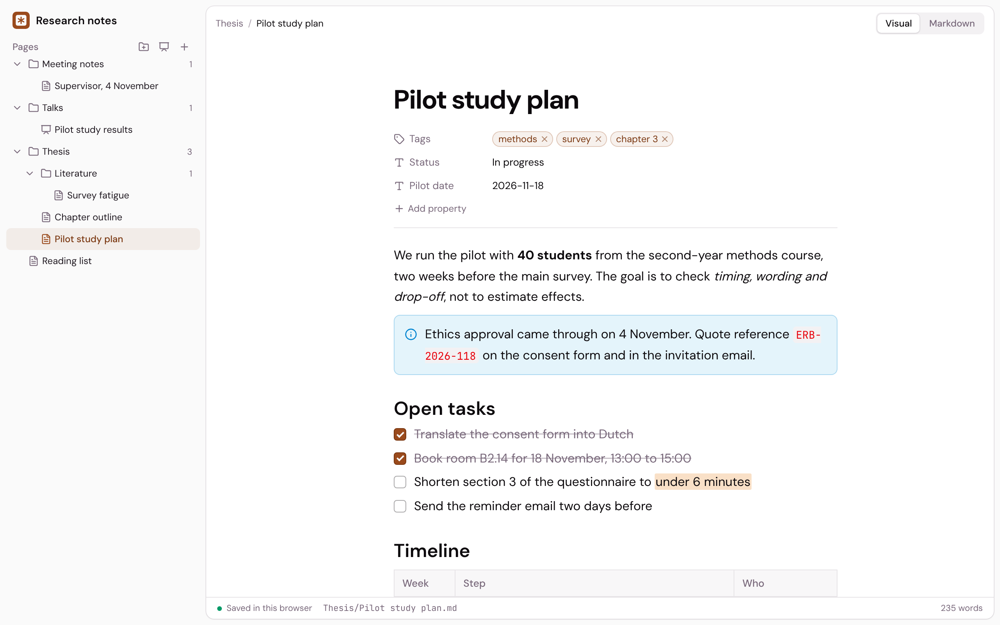

<p align="center">
  
</p>

<h1 align="center">Cursive</h1>

<p align="center">
  <strong>Write, present, teach</strong><br>
  An academic editor for taking notes, building presentations and creating tutorials.
</p>

<p align="center">
  <a href="https://github.com/dwarsbit/cursive/actions/workflows/ci.yml"></a>
  <a href="LICENSE"></a>
  <a href="https://github.com/dwarsbit/cursive/releases"></a>
</p>

<p align="center">
  <a href="CHANGELOG.md">Changelog</a> ·
  <a href="https://github.com/dwarsbit/cursive/releases">Releases</a> ·
  <a href="https://github.com/dwarsbit/polemic">Polemic</a>
</p>

<p align="center">
  
</p>

Cursive is an academic editor for taking notes, building presentations and
creating tutorials, for macOS, Windows, Linux and the browser. It is made
for students, researchers and teachers: notes for a course or a thesis,
slides for a talk, and tutorials with quizzes and assignments for a class.
You write in blocks, and every page stays a Markdown file in a folder on
your computer. Cursive is open source and the companion of
[Polemic](https://github.com/dwarsbit/polemic), the LaTeX editor. A free
Polemic account adds online services: sync between your computers, editing
in the browser and publishing a project as a site.

Cursive is in early development. Version 0.1.0 is not released yet, so for
now you run it from the source, as described under [Develop](#develop).

## Features

### Write

- **Blocks**: text, headings, to-do, bulleted and numbered lists, toggle,
  quote, callout, table, code with syntax colors, equation and divider.
  Type `/` to pick one, or hover a block to add one under it or drag it to
  another place.
- **Selection toolbar**: select text to make it bold, italic, underlined,
  struck through, inline code, highlighted or a link, or to turn its block
  into another one.
- **Visual and Markdown mode**: switch with Cmd/Ctrl + /. Markdown mode
  shows the page as its file, with the title in the front matter.
- **Markdown underneath**: every block is read from and written to
  Markdown, so a page opens in any other Markdown tool. Callouts are quotes
  that open with `[!note]`, toggles are `<details>` elements and equations
  are TeX between `$$`.
- **Notes and properties**: a project is notes and presentations in folders,
  listed as a tree in the sidebar in the order you drag them into. The front
  matter of a note shows under its title: text, lists such as tags, dates,
  numbers, checkboxes and links.
- **References from Zotero**: type `@` to cite a work from the Zotero app on
  your computer or your library at zotero.org. The page keeps its own copy of
  each work, so it reads without Zotero, and shows a reference list in APA
  style. When a work changes in Zotero, the page says so and you update it or
  keep your copy. Citations are written `[@key]` and the works sit in a
  `bibliography` block, as Pandoc and other Markdown tools read them.

### Present

- **Slides**: a presentation is a page that is a set of slides. The sidebar
  lists them under it, as it lists the pages in a folder, where you add,
  delete and drag them.
- **Layouts and speaker notes**: each slide is a 16:9 page of blocks with a
  layout: title, title and content, big number or quote. A slide that holds
  more than fits says so, and you split it in two or make its text smaller.
- **Present**: show the slides full screen and move between them with the
  arrow keys. On a published site a presentation is a slide player.
- **One Markdown file**: slides sit between dividers (`---`), with a
  slide's layout in a `slide` code block and its notes in a `notes` code
  block. Other Markdown tools show the whole talk as one document.

### Teach

- **Quizzes and assignments**: add a quiz with options, points, attempts
  and an explanation, or an assignment with instructions, a due date and a
  rubric.
- **Tutorial blocks**: learning goals, key terms, a video, before and
  after, fill in the blanks, put in order, an exercise with a hint and a
  model answer, and flashcards.
- **Progress for readers**: on a published tutorial, readers check their
  answers, see their points and mark pages as complete. The correct answers
  stay on the server until a quiz is answered.
- **Learners and grading** (paid plan): readers sign in with a Polemic
  account to keep their progress and hand in assignments as text or a file.
  You see their work under **Publish → Learners**, give points per
  criterion and write feedback.

### Publish

- **Desktop app**: a project is a folder in the Cursive folder in your home
  folder, or any other folder you open. Each page
  is a `.md` file in it, saved as you type, and a page or folder you delete
  moves to the trash.
- **Sync** (Polemic account): sync the folder to your account. Changes
  travel both ways, also the ones you made offline, and two changes to the
  same page are both kept.
- **In the browser** (Polemic account): open and edit the projects in your
  account at `/cursive` on the Polemic server.
- **Sites** (Polemic account): the **Publish** button makes a site of the
  project's pages, at an address you choose. Publish again to bring the
  site up to date, or unpublish it.
- **Themes**: give a site one of six themes: Cursive, Journal, Plum,
  Blueprint, Midnight or Poster. A theme sets the colors, typefaces and
  shapes of every page, slide and quiz.
- **PDF**: the **Export** button, or Cmd/Ctrl + P, exports a page, a
  presentation or the whole project. Cursive opens the print window, where
  you choose “Save as PDF”. A presentation is one slide per page, or the
  slides with their speaker notes under them.

Sync carries the pages, the `.md` files. An empty folder stays on the
computer it was made on.

## Compared with Polemic, Notion and Obsidian

|                              | Cursive                            | Polemic             | Notion                      | Obsidian              |
| ---------------------------- | ---------------------------------- | ------------------- | --------------------------- | --------------------- |
| Made for                     | Notes, presentations and tutorials | Papers in LaTeX     | Team workspaces             | Personal notes        |
| Runs on                      | Desktop and browser                | Desktop             | Browser, desktop and mobile | Desktop and mobile    |
| Files on your own machine    | Yes, Markdown                      | Yes, LaTeX          | No                          | Yes, Markdown         |
| Open source                  | Yes                                | Yes                 | No                          | No                    |
| Block editor with a `/` menu | Yes                                | No                  | Yes                         | No                    |
| Source of every page         | Yes, Markdown                      | Yes, LaTeX          | No                          | Yes, Markdown         |
| PDF as the result            | No                                 | Yes                 | No                          | No                    |
| Publish as a site            | Yes, with an account               | No                  | Yes                         | Yes, as a paid add-on |
| Slides                       | Yes                                | With LaTeX packages | No                          | Yes                   |
| Quizzes and assignments      | Yes                                | No                  | No                          | No                    |
| Citations from Zotero        | Yes, in APA style                  | Yes, with BibTeX    | No                          | With plugins          |
| Mobile app                   | No                                 | No                  | Yes                         | Yes                   |

- **Compared with Polemic**: Polemic is for the paper itself: LaTeX, a
  bibliography and a PDF that reviewers comment on. Cursive is for what
  surrounds the paper: your notes, the talk and the course. Both keep
  plain files on your machine and use the same account.
- **Compared with Notion**: Notion keeps your pages in its own workspace
  online, with databases and teams. Cursive keeps each page as a Markdown
  file in a folder you choose, and adds slides, quizzes and assignments. It
  has no databases.
- **Compared with Obsidian**: both work on a folder of Markdown files.
  Obsidian has links between notes, a graph and plugins. Cursive has a
  block editor, slides with layouts, and quizzes and assignments with
  grading.
- **Switching to Cursive**: open any folder of Markdown files as a project.
  Cursive reads the front matter of each file as the page's properties.

## Develop

Cursive is a Tauri app: a React front end in `src/` and a Rust back end in
`src-tauri/`. The same front end runs in a browser.

### Requirements

- Node.js 22 or later and pnpm
- Rust (stable) with cargo and the
  [Tauri prerequisites](https://tauri.app/start/prerequisites/), for the
  desktop app

### Run

```bash
pnpm install
pnpm tauri dev    # the desktop app
pnpm dev          # a demo in the browser, at http://localhost:1430
pnpm dev:web      # the browser app as the server serves it, at /cursive/
```

`pnpm dev` keeps a sample project in the browser's own storage.
`pnpm dev:web` needs a Polemic server on this computer
([polemic-server](https://github.com/dwarsbit/polemic-server)'s
`pnpm dev:api`), or the one `CURSIVE_SERVER` names; sign in on that server
first. The desktop app signs in to `https://app.polemicapp.com`; start it
with `CURSIVE_SERVER=http://localhost:3000` for a server on this computer.

### Check

CI runs the same checks on every pull request.

```bash
pnpm lint
pnpm test
cd src-tauri && cargo test
```

### Build

```bash
pnpm tauri build  # the desktop app
pnpm build:web    # the browser app, into dist-web
```

### More

- `src/editor`: the blocks and their Markdown form
- `src/components`: the two editors, the sidebar and the dialogs
- `src/references`: citations, the `bibliography` block, APA style and
  Zotero (`zotero.ts`)
- `src/lib`: a page as a Markdown file (`page-file.ts`), a project as a
  folder of pages (`project.ts`) and its stores for the desktop app, the
  demo and the server, and sync (`link-sync.ts`)
- `src-tauri`: the desktop app, which reads and writes the project's
  folder and signs in to the account
- `docker/web`: the image of the browser build, which the **Web image**
  workflow pushes to `ghcr.io/dwarsbit/cursive-web`
- [Releasing](docs/releasing.md): how a version is built and published
- [Content style](CONTENT.md): the rules for all public text, from the
  Polemic design system. Change them there first.

## License

[GPL-3.0](LICENSE)
